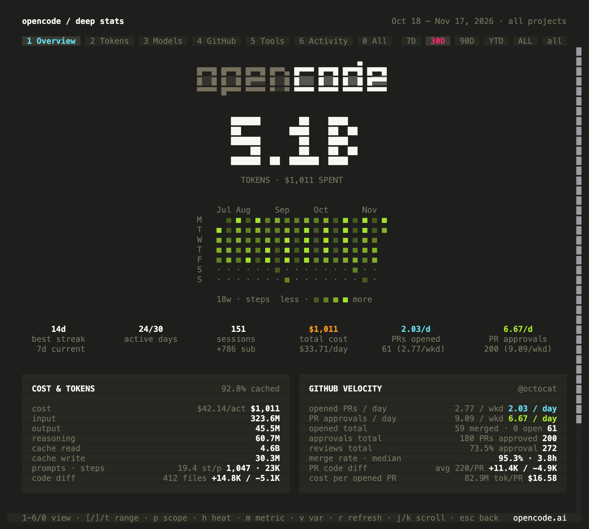
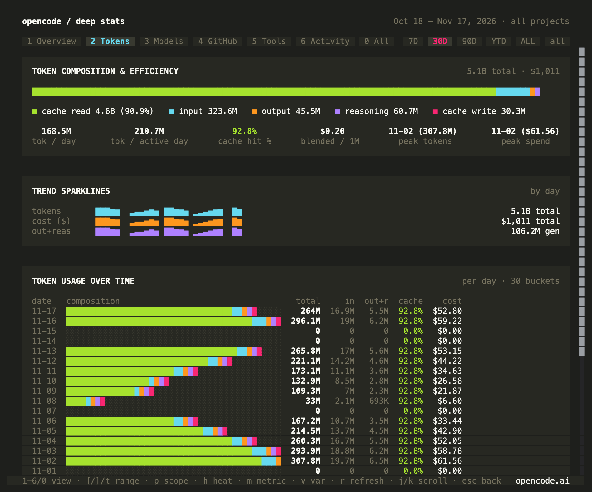
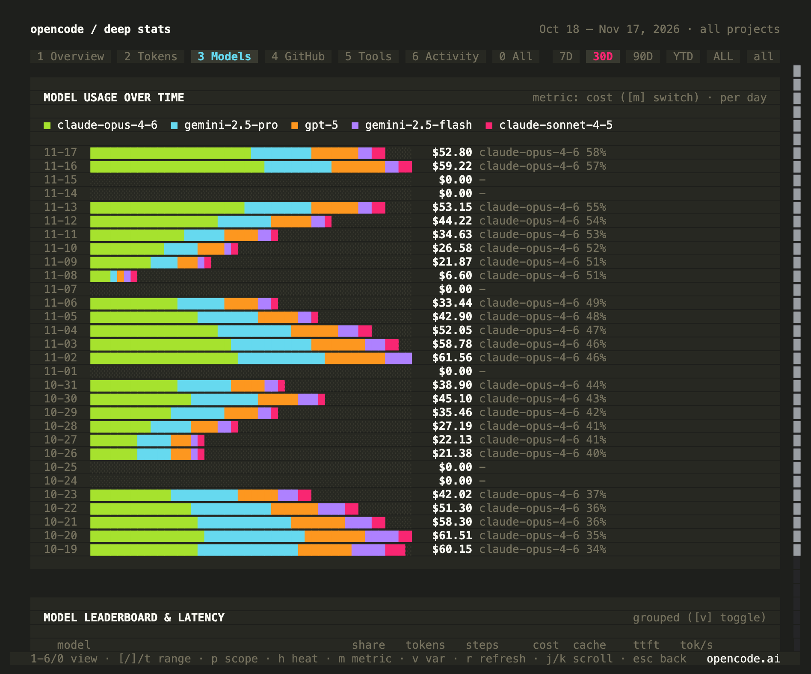
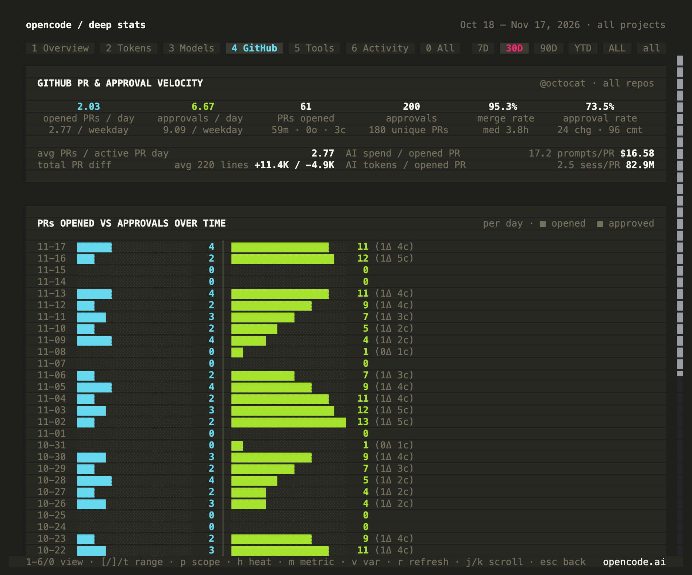
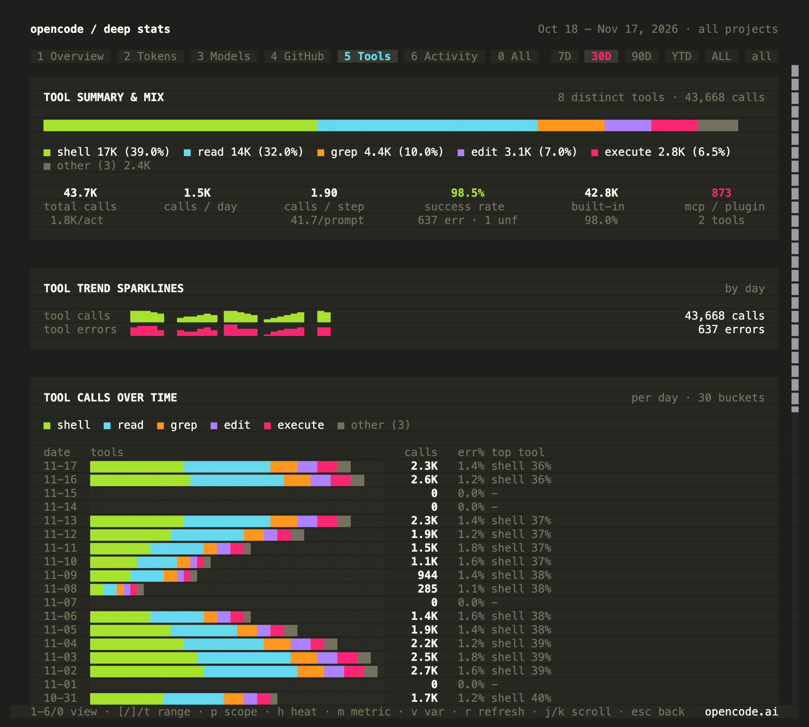
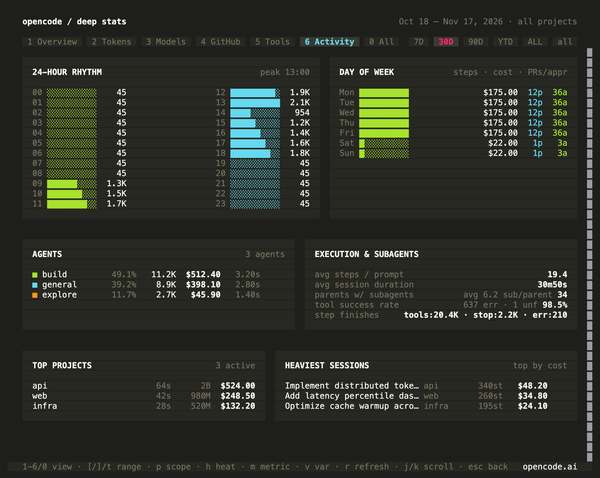

# opencode-deep-stats

> **Disclaimer:** Created with [OpenCode](https://opencode.ai).

A deep analytics & GitHub PR velocity plugin for **OpenCode V2** (`/deep-stats`) that matches OpenCode's native `/stats` visual aesthetic while adding interactive views, time-series charts, model latency metrics, tool p50/p95 reliability, and GitHub PR & review velocity.



## Features

- **Matches OpenCode `/stats` aesthetic** — Native theme tokens, pixel logo, big block-digit hero, and 53-week `M–S` activity heatmap (switchable across Steps, Tokens, Cost, and GitHub PRs + Approvals).
- **Token Usage Over Time** — Daily/weekly stacked composition bars (Cache Read, Input, Output, Reasoning, Cache Write), trend sparklines, cache hit rate %, blended $/1M tokens, and peak token/spend day callouts.
- **Model Usage Over Time** — Stacked timeline showing how your model mix & spend shifted day-by-day/week-by-week (toggle Cost / Tokens / Steps), plus a full model leaderboard with **TTFT p50**, **output tok/s**, and `#variant` grouping toggle.
- **GitHub PRs Opened & Approvals Per Day** — Powered by the `gh` CLI + GitHub GraphQL (including private & SAML-protected org repositories):
  - Average opened PRs per calendar day & per weekday
  - Average approvals per calendar day & per weekday
  - Merge rate, median time-to-merge, approval rate, PR diff sizes
  - Dual PRs Opened vs Approvals timeline chart
  - Top repositories breakdown & AI efficiency ratios (`$/PR`, `tokens/PR`, `prompts/PR`, `sessions/PR`)
- **Dedicated Tools View (`[5] Tools`)** — Tool mix stacked summary (`built-in` vs `mcp/plugin`, calls/day, calls/step, success rate), tool call & error sparklines, stacked **Tool Calls Over Time** timeline, full **Tool Reliability & Latency** table (`calls`, `err%`, `p50`, `p95`, `avg`), and external/MCP tools breakdown.
- **Activity, Agents, Projects & Sessions (`[6] Activity`)** — 24-hour coding rhythm, day-of-week breakdown, agent breakdown, execution/subagent fan-out stats, top projects, and heaviest sessions.
- **Fast Incremental Cache** — Indexes `opencode.db` into `~/.cache/opencode/deep-stats-rollup.v1.db` by UTC hour and caches GitHub GraphQL results (`~/.cache/opencode/deep-stats-github.v1.json`) so subsequent opens load in ~200ms even on multi-GB databases.
- **Agent Tool Included** — Registers a `deep_stats` tool on the OpenCode server so you can also query your analytics directly in conversation.

## Screenshots

### Token Usage Over Time (`[2] Tokens`)


### Model Usage Over Time (`[3] Models`)


### GitHub PRs & Approvals Per Day (`[4] GitHub`)


### Tool Calls Over Time & Reliability (`[5] Tools`)


### Activity Rhythm, Agents & Sessions (`[6] Activity`)


## Requirements

- **OpenCode V2** (`opencode >= 2.0.0`)
- **GitHub CLI (`gh`) — required for GitHub PR & approval stats**:
  The plugin relies on a locally installed and authenticated [`gh`](https://cli.github.com/) CLI (`gh auth token`) to query GitHub's GraphQL API. Without `gh` installed and logged in, the GitHub PRs & approvals panels will show as unavailable (all local OpenCode token/model/tool stats still work normally).
  - Install: `brew install gh` (macOS) or see [cli.github.com](https://cli.github.com/)
  - Authenticate: `gh auth login` (for private/SAML organization repos, ensure your token has `repo` and `read:org` access and is SSO-authorized if your org uses SAML)
  - Verify: `gh auth status`
  - GitHub Enterprise Server: set `GH_HOST` if targeting an enterprise host instead of `github.com`

## How Data Is Collected

- **OpenCode analytics** — Read locally (read-only) from OpenCode's SQLite database (`opencode.db`) and incrementally rolled up into `~/.cache/opencode/deep-stats-rollup.v1.db`.
- **GitHub PRs & approvals** — Runs `gh auth token` locally to authenticate with GitHub GraphQL, resolves the active user via `viewer.login`, and searches PRs authored by you (`is:pr author:<login>`) and PRs reviewed by you (`is:pr reviewed-by:<login>`) to count opened PRs, merges, and review approvals over time. Results are cached for 5 minutes in `~/.cache/opencode/deep-stats-github.v1.json`.

## Install

### Option 1: Via OpenCode CLI (recommended)

```sh
opencode plugin add github:lucasoskorep/opencode-deep-stats
```

### Option 2: Global or Project `opencode.jsonc` (Server + RPC + TUI)

Add the plugin to `~/.config/opencode/opencode.jsonc` (global) or `./opencode.jsonc` (project):

```jsonc
{
  "$schema": "https://opencode.ai/config.json",
  "plugins": [
    "github:lucasoskorep/opencode-deep-stats"
  ]
}
```

Or with options:

```jsonc
{
  "$schema": "https://opencode.ai/config.json",
  "plugins": [
    {
      "package": "github:lucasoskorep/opencode-deep-stats",
      "options": {
        "slashName": "deep-stats",
        "aliases": ["dstats", "stats+"]
      }
    }
  ]
}
```

### Option 3: TUI-Only via `cli.json`

To load only the TUI dashboard (for example, when connecting to a remote OpenCode server where the server plugin isn't installed), add it to `~/.config/opencode/cli.json`:

```json
{
  "$schema": "https://opencode.ai/v2/cli.json",
  "plugins": [
    "github:lucasoskorep/opencode-deep-stats"
  ]
}
```

### Option 4: Local Clone

```sh
git clone https://github.com/lucasoskorep/opencode-deep-stats.git
```

Then reference the local directory path in `~/.config/opencode/opencode.jsonc`:

```jsonc
{
  "$schema": "https://opencode.ai/config.json",
  "plugins": [
    "/path/to/opencode-deep-stats"
  ]
}
```

OpenCode hot-reloads config changes automatically (or run `/reload` / `opencode reload`).

## Usage

In the OpenCode TUI:

- Run `/deep-stats` (aliases: `/dstats`, `/stats+`)
- Or open the Command Palette (`Ctrl+P`) and select **Deep usage statistics**

You can also pass arguments directly to jump to a range or tab:

```text
/deep-stats 7d
/deep-stats 90d github
/deep-stats tools
/deep-stats models
/deep-stats tokens
/deep-stats full
```

### Keyboard Shortcuts

| Key | Action |
| --- | --- |
| `1`–`6`, `0` | Switch views (`Overview`, `Tokens`, `Models`, `GitHub`, `Tools`, `Activity`, `All`) |
| `Tab` / `Shift+Tab` | Next / previous view |
| `[` / `]` or `t` | Cycle time range (`7D`, `30D`, `90D`, `YTD`, `ALL`) |
| `p` | Toggle scope (`all projects` ↔ `current project`, including detected GitHub repo) |
| `h` | Cycle heatmap metric (`steps`, `tokens`, `cost`, `PRs + approvals`) |
| `m` | Cycle model timeline metric (`cost`, `tokens`, `steps`) |
| `v` | Toggle model variants (`grouped` vs `#variant`) |
| `r` | Force refresh SQLite + GitHub data |
| `j` / `k`, `↑` / `↓`, `PgUp` / `PgDn`, `g` / `G` | Scroll |
| `Esc` / `q` | Close and return |

## Options

| Option | Type | Default | Description |
| --- | --- | --- | --- |
| `enabled` | `boolean` | `true` | Set `false` to disable the server or TUI plugin |
| `slashName` | `string` | `"deep-stats"` | Custom slash command name (TUI) |
| `aliases` | `string[]` | `["dstats", "stats+"]` | Slash command aliases (TUI) |

## Development

Uses [mise](https://mise.jdx.dev/) to manage Bun and development tasks (`mise.toml`):

```sh
mise install
mise run install
mise run typecheck
mise run test
mise run check      # runs typecheck + test
```

## License

[MIT](LICENSE)
